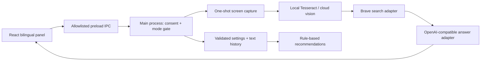

# Winbot MVP architecture

Electron + React/TypeScript trades a larger runtime for mature tray, capture, hotkey, and window support. The renderer has no Node access and cannot capture the screen. Core contracts and orchestration are framework-independent for future mobile adapters.

## Folders
- `src/core`: interfaces, settings validation, pipeline, recommendation rules.
- `src/providers`: OCR, search, LLM implementations; keys exist only in main process.
- `src/desktop`: capture, tray, hotkey, consent, IPC, local storage.
- `src/ui`: bilingual consent, answers, customization, history.
- `tests`: deterministic core tests with injected providers.

## Data flow and privacy
Consent is session-only and cannot be imported. Enabling Answer Mode captures once; a separate capture action/hotkey captures again only while enabled. Disabling mode or revoking consent aborts pending work and discards its result. No polling or recording exists. Capture badge and tray state precede capture. The panel briefly hides so it does not obscure the question; the tray stays visibly marked. Primary display is captured (Wayland may present an OS source picker).

Screenshots are memory-only buffers, released after OCR. Local OCR downloads Hindi/English model data on first use unless TESSDATA_PATH is configured. Cloud vision uploads screenshots; local OCR sends extracted text to search and answer services. Provider retention policies still apply. History stores text and source metadata only, capped at 30 entries. Logs include event/error codes only.

Search snippets are untrusted context, never instructions. LLM responses are rendered as text, never executable HTML. Sources are actual search results; only HTTP(S) links can open externally. Settings imports are schema-validated and cannot alter credentials, consent, or API endpoints.

## Milestones
1. Architecture and build scaffold.
2. Provider contracts, pipeline, validation and tests.
3. Electron capture, consent, persistence and tray.
4. Bilingual UI, customization and recommendations.
5. Build/test validation and OS setup documentation.

## Trace mode

`trace-overlay.tsx` (isolated renderer) → validated IPC → `TraceSession` → `captureRegion` → native worker → `TracePipeline` → local `TraceOCR` pool → optional search → `TraceLLM` streamed results → numbered cards in main renderer.

The session owns overlay lifecycle and monitor geometry. Only selection commands are allowed from its renderer; settings, consent, and external links remain main-panel commands. Region validation and consent are checked in the main process. The native worker never receives API keys. The pipeline owns text-only caching and parallel batching; abort signals stop capture and network requests and terminate OCR workers. Settings changes cancel work using old settings. Renderer events are `trace-reset`, `trace-item`, and `trace-submit-request`.
